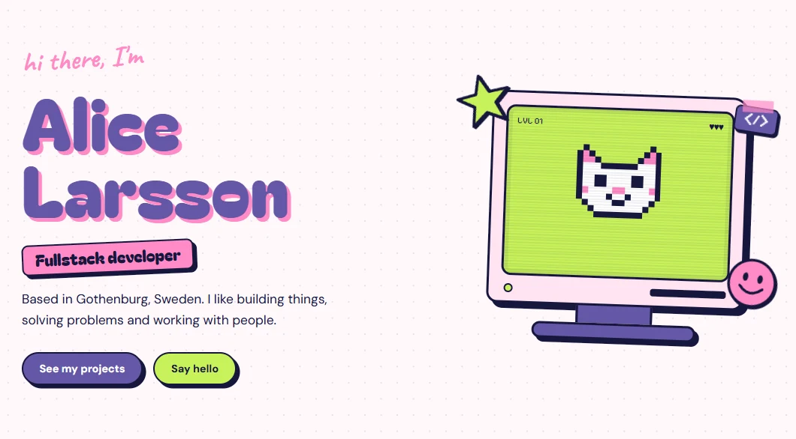

# Alice Larsson · Portfolio

My personal portfolio, designed in Figma and built with React and TypeScript.

🔗 **Live site:** [LÄNK KOMMER]



## About

A playful, colorful one-page portfolio with a Y2K/scrapbook feel. It has four sections: About me, Skills, Projects and Contact.

## Tech

- React
- TypeScript
- Vite
- CSS
- Figma (design)
- Claude Code (AI-assisted development)

## Features

- Responsive layout for desktop, tablet and mobile
- Project cards with a video preview on hover
- Project, skills and contact data kept in separate files in `src/data`, so it's easy to update
- Smooth scrolling between sections, turned off for users who prefer reduced motion

## Run it locally

```bash
git clone https://github.com/alicelarsson95/Portfolio.git
cd Portfolio
npm install
npm run dev
```

Then open `http://localhost:5173`.

## Contact

- GitHub: [alicelarsson95](https://github.com/alicelarsson95)
- LinkedIn: [LÄNK](https://www.linkedin.com/in/alice-larsson-859783162/)
- Email: [alicelarsson95@hotmail.com]
